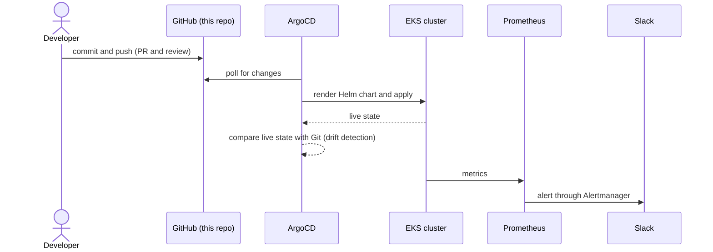

# k8s-gitops-config

The Git repository that **ArgoCD watches**. Every deployment to the cluster happens by pushing a change here. There are no manual `kubectl` changes.

Part of a three-repo project: [k8s-gitops-platform](https://github.com/viraj-vg/k8s-gitops-platform) (Terraform) | [k8s-ansible-config](https://github.com/viraj-vg/k8s-ansible-config) (Ansible) | **k8s-gitops-config** (this repo).

**Demo video (3 min):** TODO: add link

## Repository layout

```
argocd/        ArgoCD Application manifests (declarative, not created in the UI)
charts/        Helm charts: ui, catalog, cart (values.yaml, values-dev.yaml, values-prod.yaml)
monitoring/    kube-prometheus-stack values
platform/      Namespaces and shared platform resources
docs/          GitOps workflow and monitoring runbook
```

## GitOps flow



See [docs/gitops-workflow.md](docs/gitops-workflow.md) for the full workflow.

## Applications

| ArgoCD Application | Chart | Values file | Namespace |
|---|---|---|---|
| `platform` | `platform/` | n/a | creates `staging` and `production` |
| `ui-staging` / `ui-production` | `charts/ui` | `values-dev.yaml` / `values-prod.yaml` | `staging` / `production` |
| `catalog-staging` / `catalog-production` | `charts/catalog` | `values-dev.yaml` / `values-prod.yaml` | `staging` / `production` |
| `cart-staging` / `cart-production` | `charts/cart` | `values-dev.yaml` / `values-prod.yaml` | `staging` / `production` |
| `kube-prometheus-stack` | Helm chart | `monitoring/` | `monitoring` |

Staging reads `values-dev.yaml`, production reads `values-prod.yaml`. A change in one environment's values file does not touch the other.

## Deploying a change

1. Edit the chart or values file.
2. `git add <file>` (name the file, do not use `git add -A`), commit and push.
3. ArgoCD detects the commit and syncs.
4. Check: `kubectl -n argocd get applications`

Roll back with `git revert <commit>` and push. ArgoCD applies the revert.

## Documentation

- [GitOps workflow](docs/gitops-workflow.md)
- [Monitoring runbook](docs/monitoring-runbook.md)
- [Deployment guide](https://github.com/viraj-vg/k8s-gitops-platform/blob/main/docs/deployment-guide.md) (full rebuild, in the platform repo)

## Never commit

`*.tfstate*`, `.vault_pass`, Slack webhooks, Grafana or ArgoCD passwords. `*.tfstate*` is in `.gitignore`.
