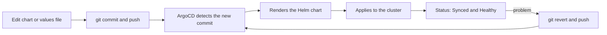

# GitOps workflow

## Principles

- Git is the single source of truth. The cluster is made to match it.
- ArgoCD Applications are declared in `argocd/` and applied once to bootstrap. They are not created in the UI.
- Changes go through a commit (and a pull request where possible). Nobody edits resources with `kubectl edit`.

## Bootstrap (once per cluster)

```bash
kubectl apply -f argocd/platform-app.yaml                  # namespaces first
kubectl apply -f argocd/kube-prometheus-stack-app.yaml     # monitoring
for f in argocd/*-staging-app.yaml argocd/*-production-app.yaml; do kubectl apply -f "$f"; done
```
The monitoring Secrets must exist before the monitoring Application starts. See the deployment guide.

## Day-to-day change



## Environments

| | Staging | Production |
|---|---|---|
| Namespace | `staging` | `production` |
| Values file | `values-dev.yaml` | `values-prod.yaml` |
| Used for | trying changes, demos | the stable workload |

Example difference: `cart` requests 256Mi and limits 512Mi by default, and production overrides these to 384Mi and 768Mi in `values-prod.yaml`.

## Example: memory incident and fix

1. Lowered the `cart` memory limit in `charts/cart/values-dev.yaml` and pushed (staging only).
2. ArgoCD applied it. The pod passed 80% of its limit.
3. `PodMemoryHigh` fired in Prometheus and reached Slack.
4. Ran `git revert` and pushed. ArgoCD restored the 512Mi limit and the alert resolved.

This was a simulation of memory pressure, not a real memory leak.

## Checking state

```bash
kubectl -n argocd get applications                  # all Synced and Healthy
kubectl -n staging get pods
kubectl -n staging get deploy cart -o jsonpath='{.spec.template.spec.containers[0].resources}'; echo
```

## Known issues

- `ui` can show `Progressing` although its pod is `Running`. Check `kubectl -n staging get svc,ingress`.
- `kube-prometheus-stack` can keep an old `Sync failed` entry from a broken Alertmanager config during setup. The current state was `Synced` and `Healthy`.
